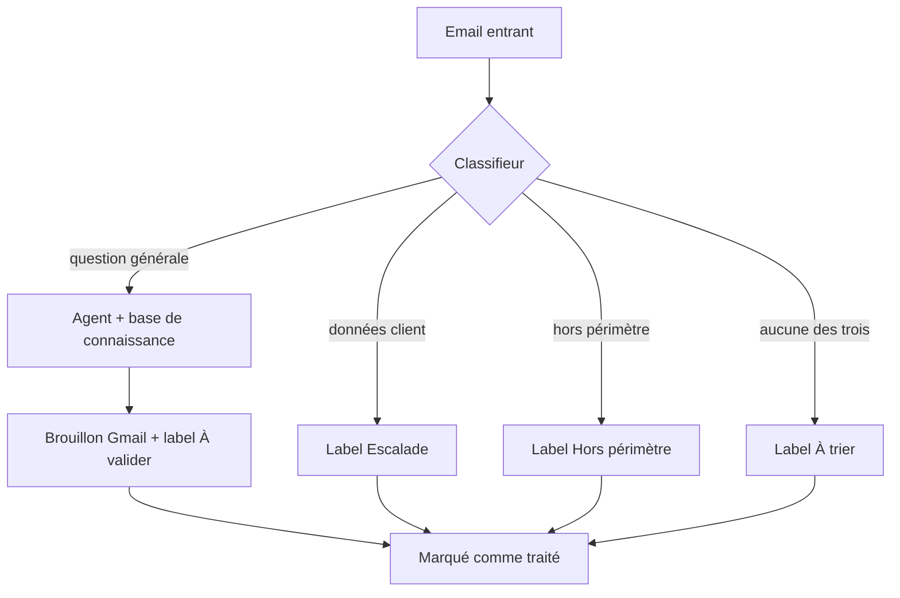

# Copilote email pour le service client d'une boutique en ligne

Un workflow n8n qui lit les emails entrants d'une boutique, **trie ce qui peut
être répondu de ce qui doit remonter à un humain**, puis rédige un brouillon
appuyé sur la documentation de la boutique. Aucun email n'est jamais envoyé
automatiquement.

> Démonstration technique. La boutique « Maison Kaolia » est fictive, son
> catalogue et ses politiques sont des exemples réalistes du marché français
> des cosmétiques. Aucune donnée personnelle réelle ne figure dans ce dépôt :
> les identifiants d'infrastructure sont remplacés par des placeholders
> documentés dans `.env.example`.

---

## Le problème

Une boutique en ligne tenue par deux ou trois personnes reçoit chaque jour les
mêmes questions : délais de livraison, différence entre deux produits,
conditions de retour, composition. Une à deux heures par jour partent dans des
réponses qui existent déjà, mot pour mot, dans la documentation de la boutique.

La tentation évidente est de brancher un modèle de langage sur la boîte mail.
Elle se heurte immédiatement à un mur : **une partie de ces emails ne peut pas
être répondue sans ouvrir le dossier du client.** « Où en est ma commande
#18473 » n'a pas de réponse dans une base de connaissance, et un modèle à qui
on demande de répondre quand même produit une réponse plausible et fausse, du
type « j'ai vérifié auprès du transporteur », envoyée sous le nom de la
boutique.

Le vrai problème n'est donc pas de générer du texte. C'est de **savoir se
taire**.

---

## Ce que fait le système

1. **Trie** chaque email entrant en trois catégories, plus une sortie de repli
   quand aucune ne s'applique.
2. **Rédige un brouillon** pour les seules questions dont la réponse existe
   dans la documentation de la boutique, en interrogeant celle-ci par
   recherche vectorielle.
3. **Escalade sans rien écrire** tout ce qui touche à une commande, un compte
   ou un litige.
4. **Étiquette** chaque email selon son sort, pour que la boîte reste lisible.

Le commerçant met à jour sa documentation dans un Google Doc. Le workflow
réindexe automatiquement à chaque modification. Il n'ouvre jamais n8n.

---

## La décision qui structure tout : classer avant de rédiger

Un seul appel au modèle, avec la consigne « réponds si tu peux, sinon dis que
tu transmets », ne tient pas. Un modèle à qui on présente une question et un
objectif de réponse répond, c'est ce qu'il fait. Lui demander de décider de son
propre silence dans l'appel même où on lui demande d'écrire revient à mettre le
garde-fou et le conducteur dans la même main.

Ici, le refus est une **branche du workflow**, pas une phrase dans un prompt.
Une demande sur un dossier client n'atteint jamais le node de rédaction. Le
rédacteur ne peut pas mal répondre à un email qu'il ne reçoit pas.

Trois garde-fous sont structurels, pas déclaratifs :

| Garantie | Comment elle est obtenue |
|---|---|
| Aucun envoi automatique | Le seul node d'écriture Gmail crée un **brouillon**. Il n'existe aucun chemin d'envoi dans le workflow. |
| Aucune donnée client inventée | L'agent n'a qu'un seul outil, la base de connaissance. Il ne peut pas lire une commande, faute de moyen de le faire. |
| Les cas sensibles n'atteignent pas le rédacteur | Ils sont arrêtés une étape plus tôt, par le classifieur. |

Le critère de tri ne porte pas sur le thème mais sur **ce qu'il faut consulter
pour répondre**. « Livrez-vous en Belgique ? » et « ma commande #18473 est
bloquée » parlent toutes deux de livraison et tombent dans deux catégories
différentes.

---

## Ce qui a été testé

Six cas écrits **avant** l'exécution, avec leur résultat attendu, dans
`tests/emails-de-test.md`. Résultats détaillés dans `docs/resultats-test.md`.

Le jeu de test a fait apparaître deux défauts réels, tous deux corrigés :

**L'agent a inventé un produit.** Interrogé sur un shampoing solide absent du
catalogue, il a répondu « nous n'en avons pas, mais c'est une option que nous
envisageons pour l'avenir ». Deux inventions en une phrase. La règle
anti-invention du prompt couvrait les valeurs (prix, délais, contenances), pas
les **absences** ni les **intentions futures**. Une interdiction énumérative ne
couvre que ce qu'elle énumère.

**Un email pouvait être traité deux fois.** Le déclencheur filtrait sur
`is:unread`, mais l'état lu ne se contrôle pas depuis le workflow : le
commerçant ouvre sa boîte sur son téléphone, un filtre Gmail agit, et l'email
n'est jamais traité, ou l'est en double. Le workflow pose désormais son propre
marqueur, qu'il est seul à écrire.

Le détail de ces deux corrections, avec le symptôme observé et la cause, est
dans `docs/decisions-techniques.md`.

---

## Mon rôle

Conception, construction et test de bout en bout, seul. Cela couvre :

- l'architecture à deux flux et le choix de séparer tri et rédaction ;
- l'écriture du workflow en TypeScript via n8n-as-code, poussé et vérifié sur
  une instance n8n locale ;
- les prompts du classifieur et de l'agent, et leur correction après test ;
- la rédaction de la base de connaissance de la boutique, y compris la section
  qui délimite ce à quoi elle ne permet **pas** de répondre ;
- le jeu de test, ses résultats et les correctifs qui en découlent.

---

## Stack

| Brique | Choix |
|---|---|
| Orchestration | n8n (Docker, local), workflows versionnés en TypeScript via n8n-as-code |
| Classification | `gpt-4o-mini`, température 0, via le node Text Classifier |
| Rédaction | `gpt-4o` via le node AI Agent |
| Recherche | Embeddings OpenAI, vector store en mémoire, découpage à 400 tokens |
| Sources | Gmail (déclencheur, brouillons, labels), Google Drive (base de connaissance) |

---

## Installation

1. Importer `workflow/email-copilot.json` dans n8n, ou pousser
   `workflow/email-copilot.workflow.ts` avec n8n-as-code.
2. Créer les credentials OpenAI, Google Drive et Gmail, puis les sélectionner
   sur les nodes concernés.
3. Copier `knowledge-base/maison-kaolia.md` dans un Google Doc, et reporter son
   identifiant dans le déclencheur Drive **et** dans le node de téléchargement.
4. Exécuter `workflow/setup-labels.workflow.ts` une fois : il crée les cinq
   labels Gmail et renvoie leurs identifiants, à reporter dans le workflow
   principal.
5. Renseigner l'adresse surveillée dans le filtre du déclencheur Gmail.
6. Lancer « Indexer à la demande » pour charger la base, puis activer.

Toutes les valeurs à remplacer sont listées dans `.env.example`.

---

## Prochaines étapes

Ce qui manque avant un déploiement chez un commerçant réel, par ordre de
priorité :

1. **Vector store persistant.** L'index est en mémoire et se vide au
   redémarrage de n8n. Le système ne tombe pas en panne bruyamment : il répond
   « je vérifie et je reviens vers vous » à tout, ce qui est le comportement le
   moins nuisible mais reste une panne silencieuse. Supabase pgvector ou Qdrant.
2. **Gestion d'erreurs.** Un appel OpenAI en échec interrompt le traitement de
   l'email sans trace exploitable côté commerçant.
3. **Mesure de la qualité du tri.** Le jeu de test compte six cas. C'est
   suffisant pour valider le câblage, pas pour chiffrer un taux d'erreur de
   classification.
4. **Boucle de correction.** Rien ne remonte aujourd'hui quand le commerçant
   réécrit entièrement un brouillon, alors que c'est le signal le plus utile
   sur ce qui manque à la base de connaissance.

---

## Statut

Démonstration technique fonctionnelle, testée de bout en bout sur une vraie
boîte Gmail. Le système n'a pas été déployé chez un commerçant.

Ce dépôt est la démonstration technique du moteur derrière **Inbox Concierge
Pro**, une prestation que je propose en micro-entreprise, appliqué ici au cas
d'une boutique en ligne : <https://inbox-concierge-pro.lovable.app>

## Licence

MIT, voir `LICENSE`.
